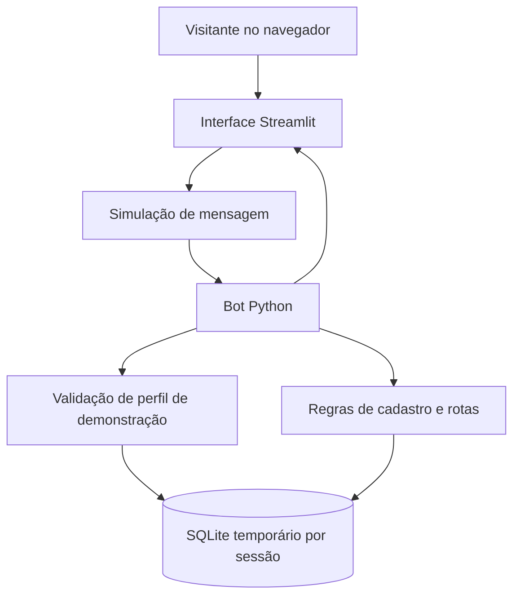

# Arquitetura atual do protótipo

**Versão demonstrativa:** Central de Rotas 0.7. Este documento descreve o código publicado, não a arquitetura definitiva da empresa contratante.

## Visão geral



Não existe integração ativa com o WhatsApp. O componente `mensagens.py` encaminha mensagens simuladas para as funções do bot.

## Componentes

| Arquivo | Responsabilidade |
| --- | --- |
| `streamlit_app.py` | Interface, conversas simuladas, indicadores e ações em botões |
| `bot.py` | Estados da conversa, comandos, verificação de papéis e transições de rotas |
| `banco.py` | SQLite, tabelas, conexões, migrações simples e persistência do estado |
| `identidade.py` | Validação matemática de CPF fictício, normalização de nome e assinatura de teste |
| `mensagens.py` | Ponto de entrada das mensagens simuladas |
| `demo_data.py` | Contatos, motoristas e rotas artificiais para a apresentação |
| `tests/` | Testes do fluxo de identificação, permissões e operações principais |

## Modelo de dados demonstrativo

- **`usuarios`:** contatos fictícios, papel, identificação simulada, situação e vínculo opcional com motorista.
- **`motoristas`:** cadastro de motoristas de teste, nome, assinatura de CPF fictício e situação.
- **`conversas`:** etapa atual e dados parciais do atendimento.
- **`rotas`:** origem, destino, data, horário, observações, status e responsável pela rota.

A interface cria um SQLite em diretório temporário por sessão. Portanto, dois visitantes acessando a demonstração **não compartilham os mesmos registros**.

## Regras importantes

1. O bot recebe o texto e o identificador de contato de demonstração.
2. O banco determina o papel do contato e sua situação.
3. No primeiro atendimento, o sistema simula o preenchimento de nome e CPF. O CPF é conferido apenas pelo algoritmo, sem consulta a bases oficiais ou autenticação forte.
4. Um motorista precisa ter cadastro fictício correspondente para acessar comandos do papel de motorista.
5. A atribuição utiliza atualização condicional em uma transação: somente uma tentativa deve conseguir mudar o status da rota de `disponivel` para `atribuida`.
6. O motorista atribuído pode iniciar ou concluir o serviço conforme as transições implementadas.
7. O administrador demonstrativo pode consultar a operação e liberar uma rota atribuída.

## Testes automatizados

O workflow [Testes do bot](../.github/workflows/testes.yml) instala Python 3.12, verifica a sintaxe e roda:

```bash
python -m unittest discover -s tests -v
```

## O que esta arquitetura **não** fornece

- Autenticação segura de clientes, motoristas e administradores.
- Integração com a API oficial do WhatsApp Business.
- Banco centralizado e persistente para a empresa.
- Registro de auditoria, backups, alta disponibilidade e monitoramento operacional.
- Gestão de caminhões e rotas fixas.
- Cobrança por coleta, documentação ambiental ou controle de resíduos por tipo e quantidade.

Esses elementos exigirão especificação e desenvolvimento próprios; o protótipo **não deve ser implantado diretamente em produção**.

[Voltar ao README](../README.md)
